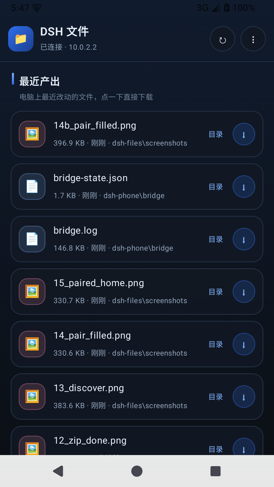
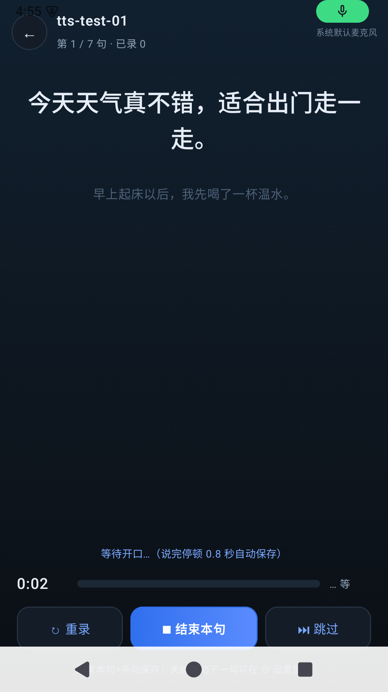
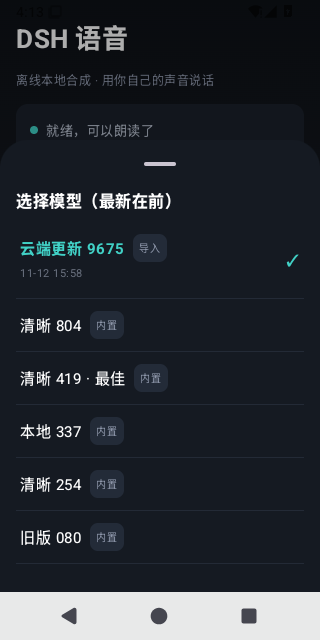
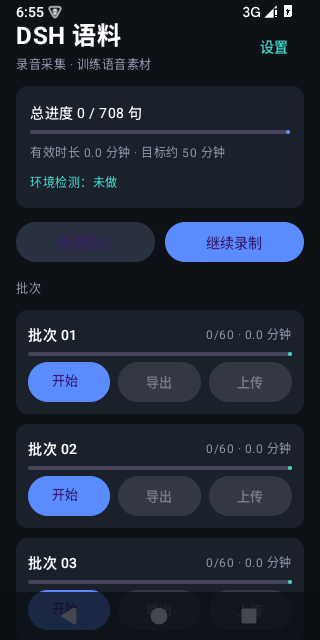

# DSH 桥接器及相关安卓软件（DSH Bridge & Apps）

> 一套围绕 **DeepSeek Harness（DSH）** 的个人助手安卓应用集：手机遥控电脑、电脑手机文件互传、离线语音合成、语音素材采集。
> 全部本地优先、数据不出局域网。

仓库地址：<https://github.com/fanhua77866/dsh-bridge-apps>

---

## 这个仓库是什么

DSH 是跑在电脑上的个人 AI 助手（DeepSeek Harness）。手机上想用时，需要一套「手机 App + 电脑桥接器」的配套工具。
这个仓库包含我们实际自用、迭代了几个月的 5 个安卓 App 和 1 个 Python 桥接器：

| 显示名 | 代号 | 包名 | 版本 | 一句话 |
|---|---|---|---|---|
| DSH 遥控 | Remote | dev.dsh.phone | 1.6 | 手机遥控电脑上的 DSH 会话（WebView + 常驻通知 + 分享文字） |
| DSH 文件 | Files | dev.dsh.files | 1.11 | 电脑文件下载到手机、手机文件发到电脑、预览/解压/播放/分享 |
| DSH 语音 | Voice | dev.dsh.voice | 7.0 | 离线 TTS：sherpa-onnx + 自训练 VITS 模型，支持模型热更新与音乐播放 |
| DSH 语料 | Corpus | dev.dsh.corpus | 1.0 | TTS 训练素材采集：逐句录音 + 实时质检 + 一键上传 |
| DSH 录音 | Recorder | dev.dsh.recorder | 2.3 | 逐句连录 + 电脑实时 ASR 逐字校验（Corpus 的前身） |
| （桥接器） | Bridge | - | 1.0 | 电脑端 Python 常驻服务：配对鉴权、文件/推送/上传、版本分发、ASR 代理 |

## 亮点

- **完全本地**：桥接器只监听局域网，文件/语音/会话都在自己的电脑上，不依赖任何云服务
- **PIN 配对 + 设备 cookie**：手机第一次输入 6 位 PIN，之后长期免输；不暴露公网时只有同一 Wi-Fi 可访问
- **App 自更新**：桥接器同时是分发服务器，安卓 App 检查 GET /app/<code>/version 后自行下载 latest.apk 安装
- **文件双向互通**：电脑推送文件到手机弹通知（dsh_push.py）、手机上传文件到电脑（/files/upload）
- **离线语音**：训练自己的 VITS 声音模型，导出 sherpa-onnx 格式后放进 App，断网也能合成
- **录音质量门禁**：Corpus 实时检查时长/峰值/削波/静音/语速，避免白录一小时

## 截图

| DSH 文件 | DSH 录音 |
|---|---|
|  |  |

| DSH 语音 | DSH 语料 |
|---|---|
|  |  |

更多截图见各 App 目录下的 screenshots/。

## 架构

    手机（同一 Wi-Fi / Tailscale）                      电脑
    ┌──────────────────────────────┐      ┌───────────────────────────────┐
    │ DSH 遥控   WebView 遥控会话  │      │                               │
    │ DSH 文件   下载/上传/推送    │ HTTP │  Python 桥接器（默认 :8799）   │
    │ DSH 语音   离线 TTS + 模型   │─────▶│   ├─ PIN 配对 / 设备 cookie    │
    │ DSH 语料   录音采集          │  WS  │   ├─ 文件浏览/下载/打包/上传   │
    │ DSH 录音   逐句录制 + ASR    │      │   ├─ 推送收件箱（通知）         │
    └──────────────────────────────┘      │   ├─ App 版本分发（APK/模型）  │
                                          │   └─ /asr 代理（可选 ASR 服务）│
                                          └──────────┬────────────────────┘
                                                     │ 本机回环
                                          ┌──────────▼────────────────────┐
                                          │ DeepSeek Harness 桌面端        │
                                          │ 会话 / 文件系统 / 训练产物      │
                                          └───────────────────────────────┘

安全边界：桥接器默认只应在可信局域网使用；对外网暴露请自行加 TLS/VPN（见 docs/SECURITY.md）。

## 目录结构

    dsh-apps/
    ├── apps/
    │   ├── remote/       DSH 遥控（安卓源码）
    │   ├── files/        DSH 文件
    │   ├── voice/        DSH 语音（模型不随仓库分发）
    │   ├── corpus/       DSH 语料
    │   └── recorder/     DSH 录音（含 asr/ 电脑端 ASR 服务脚本）
    ├── bridge/           Python 桥接器（配对/文件/推送/上传/版本分发）
    ├── docs/             架构、构建、协议、命名、隐私、安全、贡献指南
    ├── LICENSE           MIT
    └── README.md

## 快速开始

    git clone https://github.com/fanhua77866/dsh-bridge-apps.git
    cd dsh-bridge-apps

### 1. 启动桥接器（电脑端）

    cd bridge
    copy config.example.json config.json     # 修改 workspace / upload_dir / pin
    python dsh_phone_bridge.py

要求：Python 3.9+；电脑上已安装并运行 DeepSeek Harness（桥接器负责为手机拉一条独立会话通道）。

### 2. 构建安卓 App

需要 JDK 17、Android SDK（platform 35 / build-tools 35）、Gradle 8.9。

    set JAVA_HOME=...
    set ANDROID_HOME=...
    cd apps\files
    powershell -ExecutionPolicy Bypass -File build-apk.ps1

产物为 app-debug.apk。详细步骤与各 App 的特殊依赖（DSH 语音的模型文件、DSH 录音的 ASR 模型）见 docs/BUILD.md。

### 3. 手机连接

1. 手机与电脑连同一 Wi-Fi（或 Tailscale）
2. 打开 App → 输入 http://<电脑IP>:8799 → 输入电脑端 config.json 里的 PIN
3. 配对成功后开始使用

## 版本更新机制

桥接器同时是「App 更新服务器」，目录结构：

    bridge/app/<code>/version.json     # {"versionCode":1,"versionName":"1.0","size":123,"sha256":"..."}
    bridge/app/<code>/latest.apk

App 内检查 GET /app/<code>/version，判断 versionCode 变大后下载 /app/<code>/latest.apk 并调起系统安装器。
DSH 语音的模型更新走同一套机制（模型 zip 作为 latest.apk 分发），详见 docs/PROTOCOL.md。

## 文档索引

| 文档 | 内容 |
|---|---|
| [docs/ARCHITECTURE.md](docs/ARCHITECTURE.md) | 组件职责、数据流、部署形态 |
| [docs/BUILD.md](docs/BUILD.md) | 环境要求、逐 App 构建、模型/ASR 依赖 |
| [docs/PROTOCOL.md](docs/PROTOCOL.md) | 桥接器 HTTP API、配对鉴权、更新协议 |
| [docs/NAMING.md](docs/NAMING.md) | App/包名/APK/路由命名规范 |
| [docs/PRIVACY.md](docs/PRIVACY.md) | 隐私边界：不含模型与个人语音数据 |
| [docs/SECURITY.md](docs/SECURITY.md) | 安全模型、暴露公网的风险与建议 |
| [docs/CONTRIBUTING.md](docs/CONTRIBUTING.md) | 贡献指南 |
| [docs/ROADMAP.md](docs/ROADMAP.md) | 后续计划 |

各 App 的详细功能、权限、数据格式见其目录下的 README。

## 隐私与合规

- 仓库**不包含**任何训练好的语音模型、录音素材、聊天记录或个人信息
- 语音克隆功能请仅用于**本人声音**或已获得明确授权的声音；不得用于伪造他人身份、诈骗等用途
- 桥接器的 PIN、设备 cookie、文件路径均为本机配置，不要提交到公开仓库
- 详见 docs/PRIVACY.md

## License

MIT。第三方组件（sherpa-onnx、VITS、faster-whisper 等）遵循其各自许可证，见各 App README 的致谢部分。

---

## English summary

DSH Bridge & Apps is a self-hosted personal-assistant toolkit around DeepSeek Harness: five Android apps (remote control, file transfer, offline TTS, corpus recording, recorder) plus a Python LAN bridge (PIN pairing, file download/upload/push, APK/model distribution, optional ASR proxy). Everything runs locally on your own machine; no cloud dependency. Models and personal voice data are intentionally not included. MIT licensed.
