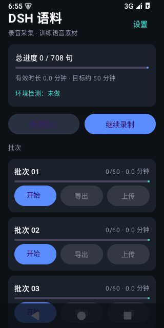
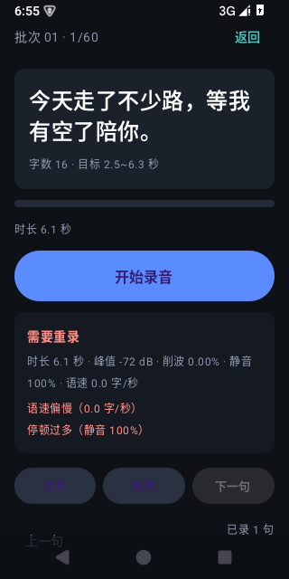

# DSH 语料（Corpus）

> 为 TTS 训练采集语音素材的安卓 App：708 句固定语料、48 kHz 无损录音、实时质检、按批打包与一键上传。


**包名** `dev.dsh.corpus` · **当前版本** 1.0 · **最低系统** Android 8.0（API 26） · **录音格式** 48 kHz / 16 bit / 单声道 WAV

DSH 语料是 [DSH 桥接器及相关安卓软件](../../README.md) 系列中的训练素材采集 App：按内置逐字稿逐句朗读，录完立刻检查时长、峰值、削波、静音、语速和底噪，不达标就重录。一个批次录完后打包成 zip，可直接在 App 里上传到电脑，交给训练流程使用。

和同系列较早的 [DSH 录音](../recorder/README.md) 相比：语料使用**固定脚本 + 强制质检**，追求素材一致性；录音则面向**可导入剧本的连续录制**，并支持电脑端实时 ASR 逐字校验。

## 功能

### 固定语料，按批推进
- 内置 **708 句 / 12 批**（前 11 批各 60 句，最后一批 48 句），逐字稿随 APK 打包，句子长度约 3～72 字
- 首页显示总进度（已录 / 708 句）、累计有效分钟数（目标约 50 分钟）和环境检测结果
- 批次卡片显示该批完成句数、有效时长和进度条，点「开始 / 继续」从该批第一句未录的句子开始
- 每句显示字数与目标时长区间（按字数估算，如「字数 16 · 目标 2.5～6.3 秒」）

### 录制
- 使用 `AudioRecord` 直接录制 48 kHz、16 bit、单声道 WAV，不经过系统录音机
- 实时电平条；单句超过 16 秒自动停止，避免超长素材
- 停止后立即写盘并计算质检指标，显示「质检通过 / 需要重录」及各项数值
- 支持试听、重录；重录会覆盖该句原来的文件
- 质检不通过时「下一句」按钮不可用，避免把问题素材带进下一句

### 实时质检
| 指标 | 说明 / 触发重录的条件 |
|---|---|
| 时长 | 超过 15 秒，或明显短于该句目标时长 |
| 峰值 / 削波 | 削波样本占比 > 0.1%（喷麦、离麦太近） |
| 静音占比 | 静音帧 > 55%（停顿过多） |
| 语速 | < 2.2 字/秒 或 > 7.5 字/秒（吞字/抢读） |
| 底噪 | 高于 -45 dB（环境嘈杂） |

所有指标同时展示，便于判断重录方向，而不是只给一个「通过/不通过」。

### 环境检测
- 录制前可做 3 秒静音检测：底噪低于 -45 dB 且峰值低于 -3 dB 视为通过
- 检测结果会显示在首页，作为整批录音环境是否合适的参考

### 导出与上传
- 每个批次可导出 zip 到手机 **下载/DSH语料**，文件名形如 `DSH语料_批次01.zip`
- 在设置里填电脑地址 + 6 位 PIN 完成配对后，可把该批 zip 上传到电脑桥接器的收件目录（默认 `手机上传`）
- 上传与导出都只包含该批已录的句子；0 句时按钮禁用

### 进度保存
- 每句的录音文件名、时长、峰值、削波、静音、语速、底噪保存在本机
- App 重启后进度仍在，可继续上一批；卸载 App 会丢失录音与进度

## 截图

| 首页（进度与批次） | 录制页（质检结果） |
|---|---|
|  |  |

> 截图来自开发过程，界面细节可能与当前版本略有差异。

## 工作原理

### 采集流程

```
选批次 → 逐句显示文本
   └─ 开始录音（48 kHz PCM 实时写入 WAV，电平条实时反馈）
        └─ 手动停止 / 16 秒自动停止
             ├─ 写盘 → 计算指标 → 显示质检结果
             ├─ 通过：试听满意 → 下一句
             └─ 不通过：试听 → 重录本句
   └─ 本批完成 → 导出 zip / 上传到电脑
```

### 质检算法

- 录音引擎每次读取 1024 个采样点，按 RMS 计算分贝值驱动电平条
- 质检在整句录完后离线计算：
  - 以 20 ms 为一帧计算 RMS，取帧 RMS 的 10% 分位作为底噪估计
  - 静音帧阈值 = `max(底噪 × 3, 0.004)`，统计静音帧占比
  - 语速 = 该句文本字数 ÷ 有效发声时长（字/秒）
  - 削波 = 幅度 ≥ 32000 的样本占比
- 各项阈值与时长目标区间都在 App 内硬编码，满足 TTS 训练素材的通用要求

### 导出与上传

```
批次 zip
├─ wav/b01_001.wav ...   # 每句一个 WAV
├─ metadata.txt          # 每行：wav/文件名<TAB>原文
└─ batch.json            # { batch, count, created, device }
```

上传流程：`POST /_bridge/pair`（PIN 换设备 cookie）→ `POST /files/upload?dir=手机上传&name=<zip>`，由电脑端桥接器写入上传目录。桥接器与协议见仓库 [bridge/](../../bridge/) 与 [docs/PROTOCOL.md](../../docs/PROTOCOL.md)。

## 权限说明

| 权限 | 用途 |
|---|---|
| `RECORD_AUDIO` | 录制语音素材（首次启动申请） |
| `INTERNET` | 连接电脑桥接器，配对与上传 |
| `MODIFY_AUDIO_SETTINGS` | 录音相关的音频参数调整 |
| 明文 HTTP（`usesCleartextTraffic`） | 桥接器是局域网 HTTP 服务，需允许明文请求 |

- 不申请存储权限：导出 zip 在 Android 10+ 通过 MediaStore 写入「下载」目录
- 不需要相机、通讯录、位置等权限

## 数据格式

### 导出 zip

```
DSH语料_批次01.zip
├─ wav/
│  ├─ b01_001.wav
│  └─ ...
├─ metadata.txt
└─ batch.json
```

`metadata.txt`（UTF-8，制表符分隔，一行一句）：

```
wav/b01_001.wav	今天走了不少路，等我有空了陪你。
wav/b01_002.wav	想起你我就忍不住笑，听见了吗。
```

`batch.json`：

```json
{
  "batch": 1,
  "count": 60,
  "created": "2026-11-13 10:00:00",
  "device": "DSH-Corpus"
}
```

### 本机存储

- 录音：App 私有目录 `files/rec` 下的 `b<批次>_<序号>.wav`
- 进度与质检指标：SharedPreferences（JSON）
- 环境检测结果：SharedPreferences

## 构建

通用环境（JDK 17、Android SDK 35、Gradle 8.9）见 [docs/BUILD.md](../../docs/BUILD.md)。本 App 没有额外的模型或 AAR 依赖。

```powershell
# 设置 JAVA_HOME / ANDROID_HOME / GRADLE_HOME 后，在仓库根目录执行
pwsh -File apps/corpus/build-apk.ps1
# 产物：apps/corpus/app-debug.apk
```

逐字稿在 `app/src/main/assets/script.json`，结构为 `{"created": "...", "version": ..., "batches": [[{"id":1,"text":"..."}, ...], ...]}`。想换一套语料时替换该文件并重新构建即可。

## 已知限制

- **语料固定**：不支持在 App 内导入其他逐字稿，替换语料需要改 `assets/script.json` 重新打包
- **录音参数固定**：48 kHz / 单声道 / 16 bit，输入使用系统默认麦克风，不提供设备与采样率选择
- 单句最长 16 秒；没有自动下一句，每句都要手动点「下一句」
- 质检是信号统计规则，不能完全替代人耳听测（吞字、口音、语气问题仍可能漏检）
- 录音过程中退出或进程被杀，当前句不会保存（停止后才落盘）
- 上传必须先在设置里完成 PIN 配对；上传目标是桥接器收件目录，不能指定其他位置
- App 没有自更新入口，升级需要重新安装 APK
- 卸载 App 会删除录音和进度，素材要先导出或上传

## 致谢

- AndroidX / Jetpack Compose（Apache-2.0）
- 语料文本、配音与训练流程均为本项目自建

## License

MIT，见仓库根目录 [LICENSE](../../LICENSE)。
