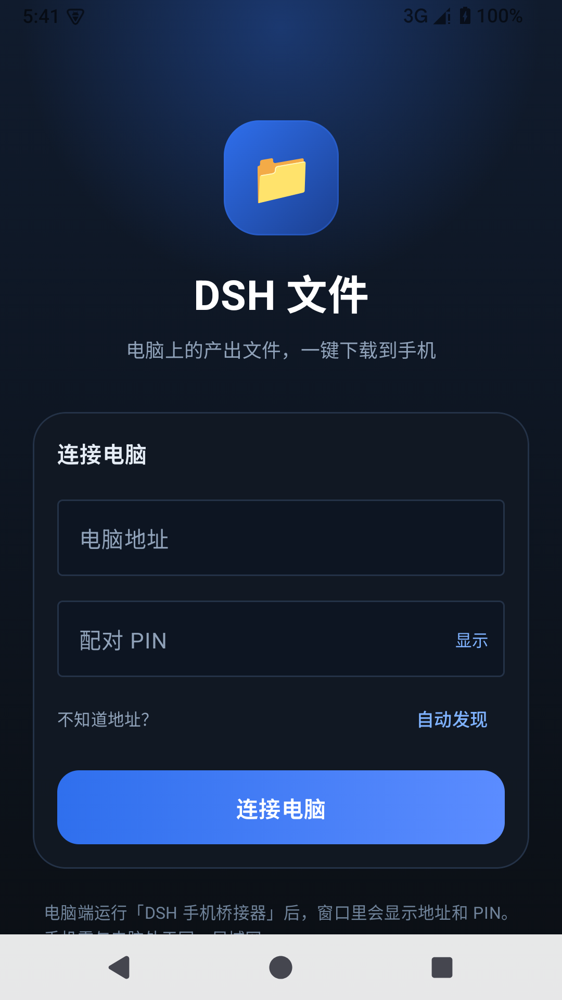
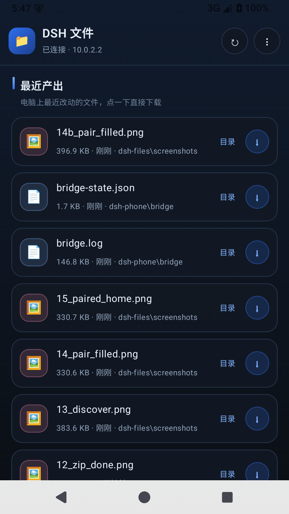
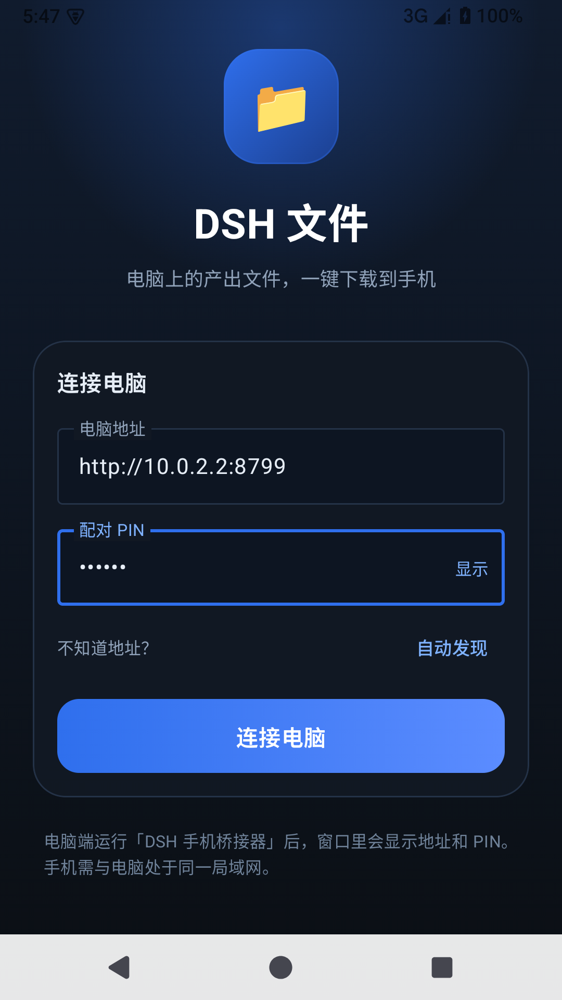
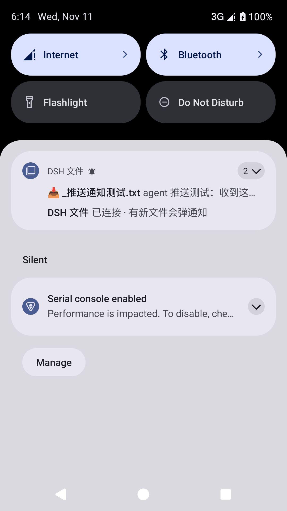
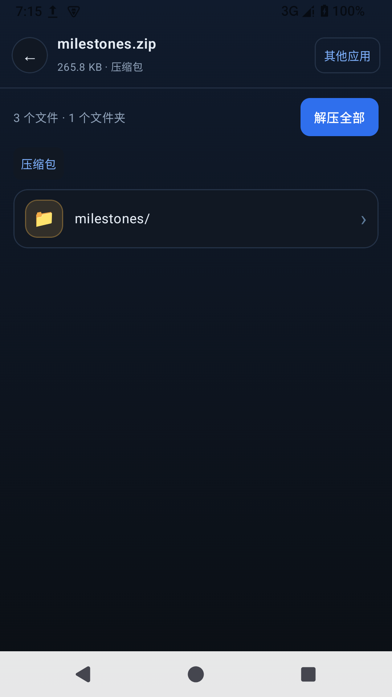

# DSH 文件（Files）

> 把电脑上的文件收进手机：浏览、下载、接收 agent 推送，在 App 内预览 / 播放 / 解压，也能把手机文件发回电脑。

[](../../LICENSE)


DSH 文件是 [DSH 桥接器及相关安卓软件](../../README.md) 的文件端 App，与电脑端桥接器配套使用。它和 [DSH 遥控](../remote/README.md) 共用同一个桥接器、各自独立配对，但专注文件场景：下载、预览、整理、上传、分享。

## 功能

### 连接与线路

- **PIN 配对**：填写电脑地址和 PIN，通过 `POST /_bridge/pair` 换取设备 cookie 并保存在 App 私有存储，后续打开免配对。
- **同一 Wi-Fi 自动发现**：不知道电脑地址时点「自动发现」，App 会扫描当前 Wi-Fi 的 /24 网段和 8799 端口，探测到桥接器的 `/_bridge/info` 后自动填好地址。
- **主备双地址（v1.10）**：可同时填写「电脑地址」和「备用地址」（例如家里局域网 + Tailscale），配对时两个地址依次尝试；日常使用中当前线路请求失败会自动切到备用地址，并记住新的主 / 备关系；⋮ 菜单也可手动「切换线路」。
- **后台推送开关**：⋮ 菜单可随时开关「后台推送」；断开连接会同时停止推送监听。

### 首页与浏览

- **首页主要内容**：更新横幅、「来自电脑的推送」、「已下载」、「最近产出」以及「浏览电脑」根目录入口。
- **最近产出**：工作区最近修改的 30 个文件，点一下直接下载，下载完自动打开。
- **浏览电脑**：工作区、用户目录、各盘符自由浏览；目录行右侧「打包」可把整个文件夹下成 zip。
- **下载**：App 内进度横幅显示百分比；单文件直接流式写入手机，目录打包走桥接器的 `/files/zip`。
- **保存位置**：Android 10+ 通过 MediaStore 保存到「Download/DSH文件」；旧系统写入公共目录失败时自动退回 App 专属目录。

### 接收推送（v1.1）

- **agent → 手机**：在仓库根目录执行 `python bridge/dsh_push.py "<文件或目录>" --note "说明"`，目录会自动打包成 zip；手机 App 前台服务每 6 秒同步一次收件箱，有新条目即发通知。
- **收件箱**：首页「来自电脑的推送」列出最近条目，带说明文字和大小，点击下载后可立即打开。
- **首次同步不补发历史通知**：只校准时间线，避免一装 App 就被旧推送刷屏。

### 预览与播放（v1.3 — v1.9）

- **内置预览**：图片（自动降采样，最长边约 2048px）、文本 / 代码（md、log、json、源码等，单文件最多 400KB）、视频（系统解码器 + 控制器）、音频（内置播放器）。
- **APK 安装**：预览页点「安装」调起系统安装器（需允许安装未知应用）；其他格式可「其他应用」交给系统 App。
- **下载过就是打开（v1.6）**：列表里已保存过的文件显示绿色动作图标，点开直接预览 / 播放 / 解压；电脑上的文件大小或修改时间变化后重新显示下载。
- **已下载列表**：首页保留最近 40 条下载记录，随时重开。
- **连续听 / 滑动切换（v1.7 — v1.8）**：预览内左右滑动或点顶部 ‹ › 切相邻文件；☰ 打开「本文件夹」侧边栏跳转；音频播完自动连播下一个同类文件，关闭预览回到原文件夹并保留滚动位置。
- **按类型区分交互（v1.9）**：音频 / 视频 ▶ 播放、图片 👁 预览、文本 📄 查看、zip 📦 解压、APK 📲 安装；zip 是容器，不再显示播放键。
- **播放器控制（v1.9）**：进度条拖动 / 点击跳转、已播 / 总时长、⏮ / ▶⏸ / ⏭、倍速 0.5x / 1x / 1.5x / 2x、循环模式（列表 / 单曲 / 不循环）、播放列表入口。
- **压缩包内试听（v1.9）**：在 zip 预览页直接点音频，会临时解压到缓存并组成包内播放列表，可连播 / 侧滑 / 列表切换；退出后自动清理缓存。

### 压缩包（v1.4）

- **zip 内浏览**：打开 zip 显示内部目录结构，进入文件夹点文件即可解压并预览。
- **解压全部**：解压到 App 专属目录 `Android/data/dev.dsh.files/files/unzip/<包名-时间>/`，完成后列出文件，可反复打开。
- **兼容性**：中文文件名兼容 UTF-8 / GBK；单包最多 8000 个文件、解压后总计最大 2GB。
- **格式限制**：内置只处理 zip；RAR / 7Z 等交给系统 App。

### 发送到电脑（v1.5）

- **入口**：首页「发送文件到电脑」卡片，或 ⋮ 菜单。
- **多选上传**：系统文件选择器可一次选多个文件，逐个显示进度（`正在发送 2/3 · 45%`），失败项单独列出。
- **保存位置**：默认目录由桥接器 `upload_dir` 决定（默认 `<workspace>/手机上传`）；也可填电脑上的自定义目录（必须在桥接器允许的根目录内）。
- **最近收到**：发送页底部列出「电脑上最近收到的」，方便确认落盘。
- **其他 App 分享进来**：相册 / 微信 / 文件管理器里「分享」到 DSH 文件，会直接打开发送页并带入文件。
- **限制**：单文件默认上限 4096MB（桥接器 `upload_max_mb` 可改）；同名文件自动加 `-1`、`-2` 后缀。

### 分享与更新

- **分享到微信 / 其他应用（v1.11）**：预览页顶部「分享」使用标准 `ACTION_SEND` + `content://` URI；**压缩包本身**和**压缩包内文件**（临时解压后）都能分享。
- **App 内更新（v1.2）**：启动时静默检查 `GET /app/files/version`，有新版本在首页显示横幅，点击下载并调起系统安装器；⋮ 菜单可手动检查。
- **深色渐变卡片界面**：列表、预览、发送页统一深色主题。

## 截图

以下为 5 张代表性截图（其余历史截图已归档，未随仓库分发）：

| 连接与配对 | 首页：最近产出 |
|---|---|
|  |  |

| 浏览电脑 | 接收电脑推送 |
|---|---|
|  |  |

| 浏览压缩包 | 发送文件到电脑 |
|---|---|
|  | |

## 工作原理

App 是桥接器的纯客户端：配对成功后拿到设备 cookie，所有文件接口都带 `Cookie: dsh_phone=<token>`；浏览、下载、打包、上传、收件箱分别由桥接器的 `dsh_files.py`、`dsh_inbox.py`、`dsh_upload.py` 处理。下载流直接写入手机存储（MediaStore），不经过中转目录；推送靠前台服务定时拉取收件箱，不依赖云推送。

```text
┌──────────────── 手机 ────────────────┐          ┌─────────────── 电脑 ────────────────┐
│ DSH 文件 App（Jetpack Compose）       │          │ bridge/                              │
│  ├─ 连接页：PIN / 自动发现 / 双地址    │  HTTP    │  ├─ dsh_phone_bridge.py（配对鉴权）  │
│  ├─ 首页 / 目录浏览 / 预览 / 播放      │ ───────▶ │  ├─ dsh_files.py（浏览 / 下载 / 打包）│
│  ├─ PushService：6 秒轮询收件箱        │  cookie  │  ├─ dsh_inbox.py（推送收件箱）        │
│  ├─ 上传：选择文件 → POST /files/upload│          │  └─ dsh_upload.py（上传落盘）         │
│  └─ 保存：MediaStore / Download/DSH文件│          │  浏览范围受 file_roots 限制           │
└───────────────────────────────────────┘          └──────────────────┬──────────────────┘
                                                                      │ 本机文件系统
                                                        workspace / 用户目录 / 盘符
```

### 数据落在哪里

- **下载的文件**：手机「Download/DSH文件」（旧系统可能退回 App 专属目录）。
- **解压全部**：`Android/data/dev.dsh.files/files/unzip/<包名-时间>/`。
- **下载记录**：App 私有 `SharedPreferences`，最多 40 条，仅用于「已下载」列表和「打开」判定。
- **推送收件箱 / 上传目录**：都在电脑端，由桥接器管理；手机只保存下载后的副本。

## 权限说明

| 权限 | 用途 |
|---|---|
| `INTERNET` | 连接桥接器，下载 / 上传文件 |
| `ACCESS_NETWORK_STATE` | 自动发现时读取当前 Wi-Fi 网段 |
| `POST_NOTIFICATIONS` | 显示电脑推送通知（Android 13+ 首次启动申请） |
| `FOREGROUND_SERVICE` / `FOREGROUND_SERVICE_DATA_SYNC` | 后台监听推送的前台服务 |
| `REQUEST_INSTALL_PACKAGES` | App 内更新、APK 预览页安装 |

- **不申请存储权限**：Android 10+ 走 MediaStore；更旧系统若无法写公共目录会自动回退。
- 不申请相机、麦克风、定位、通讯录等权限。
- `android:usesCleartextTraffic="true"`：桥接器默认 HTTP，请仅在可信局域网 / VPN 内使用。

## 构建

环境要求：JDK 17、Android SDK platform 35 + build-tools 35、Gradle 8.9（仓库**不含** gradle wrapper）。完整步骤见 [docs/BUILD.md](../../docs/BUILD.md)。

Windows 一键构建：

```powershell
cd apps/files
powershell -ExecutionPolicy Bypass -File build-apk.ps1
```

脚本会复制工程到临时目录、写入 `local.properties`、执行 `assembleDebug`，产物输出到 `apps/files/app-debug.apk`。

其他方式：

- 在 `apps/files` 下自备 `local.properties`（`sdk.dir=...`），执行 `gradle assembleDebug`；
- 用 Android Studio 打开 `apps/files`；
- 仓库没有 `gradlew` / `gradlew.bat`，无法直接 `./gradlew assembleDebug`，请使用本机 Gradle 或 Android Studio。

版本号在 `apps/files/app/build.gradle.kts` 的 `versionCode` / `versionName` 中维护（当前为 12 / 1.11）。

技术栈：Kotlin + Jetpack Compose；minSdk 26（Android 8.0）、targetSdk 35。

## 与桥接器的关系

DSH 文件不能独立工作：电脑端必须先运行桥接器，App 只负责展示和发起请求。

| 接口 | 用途 |
|---|---|
| `POST /_bridge/pair` | PIN 配对，换设备 cookie |
| `GET /_bridge/info` | 自动发现、连接状态 |
| `GET /files/api/roots` · `/files/api/recent` · `/files/api/list` | 首页、最近产出、目录浏览 |
| `GET /files/download?path=…` · `/files/zip?path=…` | 下载单文件 / 目录打包 |
| `GET /files/api/inbox` · `/files/inbox/<id>` | 推送收件箱同步 / 下载 |
| `GET /files/api/upload-info` · `POST /files/upload?dir=…&name=…` · `GET /files/api/uploads` | 上传配置、上传、最近收到 |
| `GET /app/files/version` · `/app/files/latest.apk` | App 内更新 |

- 启动、配置、日志与排错见 [bridge/README.md](../../bridge/README.md)。
- 配对鉴权、更新协议的字段说明见 [docs/PROTOCOL.md](../../docs/PROTOCOL.md)。
- 推送命令与后台服务细节见 [../../bridge/dsh_push.py](../../bridge/dsh_push.py)。
- 需要「手机遥控 DSH 会话」时用 [DSH 遥控](../remote/README.md)；两个 App 可同时安装、各自配对，互不冲突。

## 已知限制

- **必须能访问电脑**：手机与电脑需在同一局域网，或通过 Tailscale / ZeroTier / Cloudflare Tunnel 等方案互通；桥接器必须运行。
- **明文 HTTP**：默认无 TLS；不要把 `8799` 直接暴露公网，远程访问建议套隧道并加 VPN / 访问控制。
- **自动发现仅限当前 /24 网段、固定 8799 端口**：桥接器改端口或跨网段时需手动填地址。
- **内置 zip 限制**：单包最多 8000 个文件、解压后总计 2GB；RAR / 7Z 等格式需交给系统 App。
- **文本预览上限 400KB**，图片预览会按最长边约 2048px 降采样；超大文件建议用「其他应用」。
- **推送通知依赖权限与前台服务**：关闭通知权限或系统省电策略限制后台时，可能收不到提醒；首次连接不会补发历史推送。
- **「已下载」判定基于文件名 + 大小 + 修改时间**：电脑端同名同大小且未更新时，会复用手机上的旧副本。
- **上传上限默认 4096MB**（桥接器 `upload_max_mb` 可改）；自定义目标目录必须在桥接器允许的根目录内。
- **App 内更新依赖桥接器发布目录**：`bridge/app/files/{version.json,latest.apk}` 存在新版本才会提示；自编译安装包需与已装版本同签名才能覆盖升级。
- **无云同步 / 无多端历史**：下载记录只在本机，换手机不会同步。
- **最低 Android 8.0（minSdk 26）**：更低版本不保证可用。

## License

[MIT](../../LICENSE)。App 使用 AndroidX / Jetpack Compose 等第三方组件，遵循其各自许可证。
