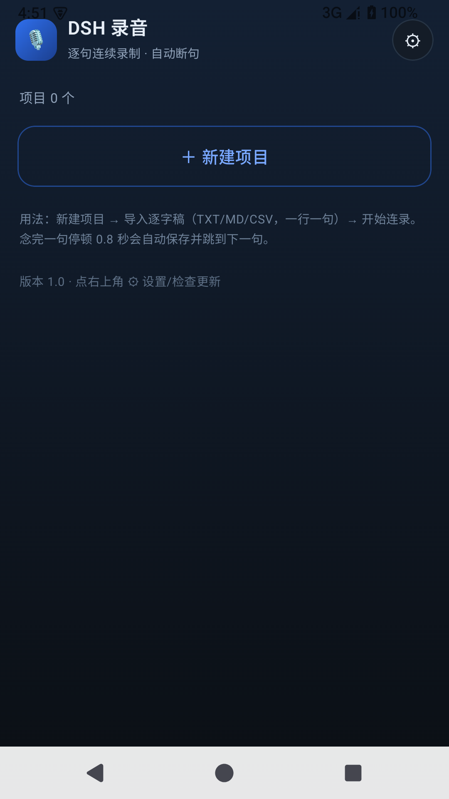
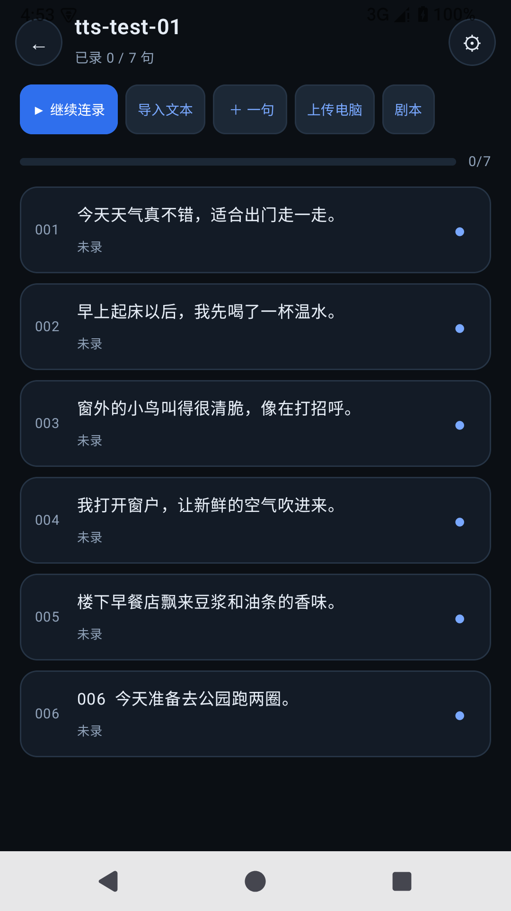
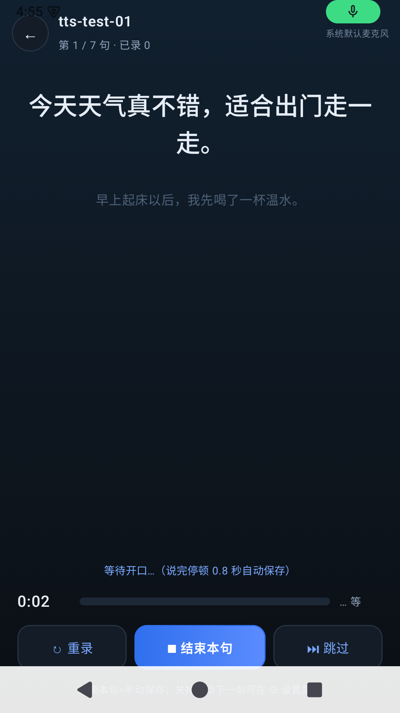
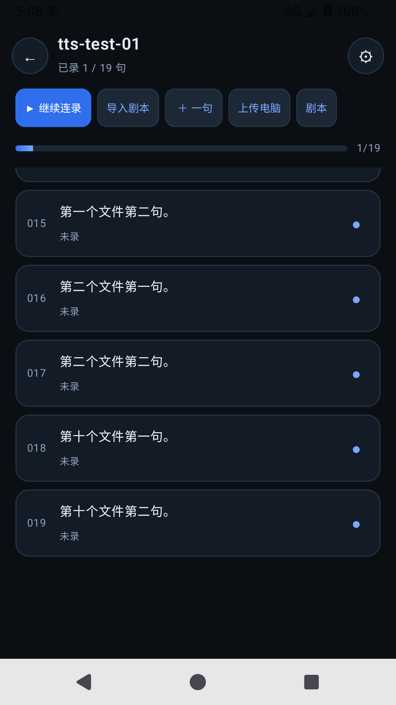

# DSH 录音（Recorder）

> 逐句连续录制 App：一个项目对应一份逐字稿，念完一句停顿一下自动保存并切到下一句；可选电脑端实时 ASR 逐字校验。


**包名** `dev.dsh.recorder` · **当前版本** 2.3 · **最低系统** Android 8.0（API 26） · **输出格式** WAV / 16 bit / 单声道

DSH 录音是 [DSH 桥接器及相关安卓软件](../../README.md) 系列中较早的逐句录制工具，也是 [DSH 语料](../corpus/README.md) 的前身：它把「一份逐字稿 → 一个项目」组织起来，用能量 VAD 自动断句实现**不打断的连录**；此外还可以把音频实时送到电脑，用 faster-whisper 做逐字对齐，读对的字变蓝、读错/漏读标红，句末保存逐字时间轴。

## 功能

### 项目与逐字稿
- 一个项目 = 一份逐字稿，**一行 = 一句**；新建项目后可随时补录
- 导入 **TXT / MD / Markdown / CSV / LOG / RTF** 单文件，或 **ZIP 整包**（按文件名自然排序 `01 → 02 → 10` 展开）
- 自动忽略空行、`#` / `//` 注释行，去掉行首编号与项目符号（如 `001.`、`- `、`·`）
- 文本编码 UTF-8 / GBK 自动识别；ZIP 内单文件上限 8 MB、合计 5000 行
- 项目详情支持添加一句、修改文字、删除句子、重命名 / 删除项目；`全部 / 未录 / 已录` 筛选
- 句子列表显示序号、原文、`已录 mm:ss` 或 `未录`，点已录句子直接播放

### 连录（自动断句 + 自动下一句）
- 点「继续连录」后从第一个未录句子开始，自动等待开口：检测到连续 3 帧（20 ms/帧）人声才开始计时
- 说完后静音超过设定时长（**0.5 / 0.8 / 1.2 / 1.5 秒**）自动结束本句、保存、响一声提示音，约 0.4 秒后自动开始下一句
- 最短有效语音（**0.2 / 0.3 / 0.5 秒**）用于过滤咳嗽、杂音；没开口时一直等待，不会把静音切成句子
- 单句最长 60 秒自动结束；录音期间保持屏幕常亮
- 底部控制：「重录」「结束本句」（手动保存）、「跳过」；提词器上下方显示上一句/下一句，当前句大字显示
- 录音页显示实时电平、计时、设备名和当前提示（等待开口 / 正在录 / 已保存）

### 实时 ASR 逐字校验（可选）
- 连接电脑端 faster-whisper 服务后，边录边把 PCM 分片送到电脑识别
- 已确认读对的字变蓝，读错/漏读的字标红（可设置宽松/标准/严格三档；口音场景可关闭标红）
- 显示「识别 matched/total 字」和最近的识别文本；句末用较大模型 + 更高 beam 做最终对齐
- 逐字时间轴来自识别结果，比估算准确；识别不可用时自动退回「估算模式」，录音不中断
- 识别模型可选 `small`（快，默认）或 `medium`（更准但 CPU 慢）；设置里可一键检测电脑 ASR 状态

### 逐字时间轴
- 每句保存逐字数组：字 + 相对 WAV 的起止毫秒 + 是否读错（`wrong`）
- 项目详情里每句 ⋯ →「查看逐字时间轴」可直接查看（升级前的旧录音或未检测到发声的句子可能没有数据）
- 导出 zip 时写入 `alignment.json`；`metadata.jsonl` 内也带同一份 `chars` 字段
- 时间轴来源：电脑 ASR 对齐优先，连不上时用「发声区间 × 语速」估算；重新录一遍会重新生成

### 设备与音质
- 输入设备：系统默认、手机麦克风、有线耳机麦、USB 麦、蓝牙麦（SCO）
- 采样率：**16 kHz / 44.1 kHz / 48 kHz**，WAV 16 bit 单声道，流式写入并在结束时回填文件头
- 每句一个独立 WAV，文件名 `序号_前12字.wav`（例如 `0001_今天天气真不错，适合.wav`）

### 上传与更新
- 项目页可将整包 zip 上传到电脑桥接器（配对后走 `/files/upload`），主地址失败自动换备用地址重试
- 「剧本」动作把整份逐字稿导出为 TXT 并用系统分享面板发送
- App 自更新：检查 `/app/recorder/version`，下载 `/app/recorder/latest.apk`，校验版本号后调起安装器
- 设置里可「自动发现」同一 Wi-Fi 下正在运行的桥接器（扫描 `/_bridge/info`）

## 截图

| 项目列表 | 逐字稿句子列表 |
|---|---|
|  |  |
| 新建项目、进度与用法提示 | 导入脚本后一行一句，可点已有录音回放 |

| 录制页（逐句提词） | ZIP 多文件导入顺序 |
|---|---|
|  |  |
| 大字提词、电平与计时，说完停顿自动保存 | `01 → 02 → 10` 按文件名自然排序展开 |

| 设置页（设备 / 采样率 / 自动断句） |
|---|

> 截图来自开发过程，版本号与界面细节可能与当前构建略有差异。

## 工作原理

### 连录状态机

```
空闲 → startAt() 启动录音线程（AudioRecord 持续写 WAV）
   └─ 等待开口：自适应噪声底 + 阈值 = max(噪声底+9dB, -46dB)
        └─ 连续 3 帧高于阈值 → speaking = true，开始计时
             └─ 静音累计 ≥ silenceMs 且有效发声 ≥ minSpeechMs
                  → 结束本句 → 保存 → 提示音 →（自动下一句？）→ 下一句 startAt()
```

- 未开口时不会自动切句；单句超过 60 秒强制结束
- 识别模式开启时，自动断句的静音阈值至少 1.5 秒，给电脑端留出对齐时间
- 自动断句但几乎没声音（有效发声 < 最短语音）→ 丢弃本次录音，重新等待开口
- 录音数据边录边写入磁盘，崩溃/取消时删除半成品文件

### 识别对齐（可选）

```
手机                       电脑（桥接器 :8799 → ASR 服务 :8801）
 │  POST /asr/session/start {script, sampleRate, model, mode}
 │ ───────────────────────────────────────────────▶ 建立识别会话
 │  POST /asr/chunk {session, seq, pcm(base64)}   （约每 1 秒一片）
 │ ───────────────────────────────────────────────▶ 滚动窗口解码 + 脚本对齐
 │  ◀──────────── {matched,total,chars,transcript}  逐字状态（0 未读/1 读对/2 读错）
 │  POST /asr/session/end {session}
 │ ───────────────────────────────────────────────▶ 整句最终对齐（beam=5）
```

- 电脑端服务用 faster-whisper（默认 CPU int8、small 模型），实时窗口最多 6 秒、每积累 1.2 秒解码一次
- 对齐方式：把识别出的字序列与脚本中「去掉标点后的字」用 `difflib.SequenceMatcher` 做最长匹配，状态 1 = 读对、2 = 读错；时间戳按词内位置均分
- 句末保存判定是双闸门：
  - **识别率**：`matched ≥ total × 比例`（宽松 0.55 / 标准 0.80 / 严格 0.90）
  - **发声时长**：实际有效发声 ≥ 期望时长（按当前语速估算）× 0.5，防止 Whisper「脑补」
- 不通过时自动删除本次录音并重录本句；手动点「结束本句」则跳过闸门、直接保存
- 每句保存后用实际发声时长校准语速估计，供下一句使用

### 估算模式

- 未连接电脑时，按「有效发声时长 × 语速估计」推算读到第几个字，读到位置变蓝
- 明显没念完（覆盖率 < 60%）自动不保存并重录本句
- 逐字时间轴由发声区间与语速估算生成，精度低于 ASR 模式，但每句都有数据

## 权限说明

| 权限 | 用途 |
|---|---|
| `RECORD_AUDIO` | 录音（首次启动申请） |
| `INTERNET` | 配对/上传到电脑、实时 ASR、检查 App 更新 |
| `ACCESS_NETWORK_STATE` | 自动发现同 Wi-Fi 电脑时读取网络状态 |
| `REQUEST_INSTALL_PACKAGES` | 下载新 APK 后调起系统安装器 |
| 明文 HTTP（`usesCleartextTraffic`） | 桥接器/ASR 均为局域网 HTTP 服务 |

- 不申请存储权限：录音在 App 专属目录，导出/上传通过 zip 缓存完成

## 数据格式

### 本机

```
files/projects.json                          # 项目 + 句子 + 逐字时间轴索引
Android/data/dev.dsh.recorder/files/
└─ projects/<项目 id>/
   ├─ 0001_今天天气真不错，适合.wav
   ├─ 0002_早上起床以后，我先喝了.wav
   └─ ...
```

- 设置项（采样率、设备、断句参数、电脑地址、PIN、token 等）在 SharedPreferences
- 句子字段：`id / text / wav / recordedAt / durationMs / sampleRate / deviceName / rate / chars`
- `chars` 为逐字数组：`[字, startMs, endMs, wrong]`（WAV 内相对时间）

### 上传 zip

项目页「上传电脑」会把项目打成 zip：

```
<项目名>.zip
├─ 0001_今天天气真不错，适合.wav
├─ 0002_早上起床以后，我先喝了.wav
├─ metadata.jsonl      # 每句一行 JSON
├─ alignment.json      # 逐字时间轴（JSON 数组）
├─ script.txt          # 逐字稿（一行一句）
└─ project.json        # { id, name, createdAt }
```

`metadata.jsonl` 示例：

```json
{"file":"0001_今天天气真不错，适合.wav","text":"今天天气真不错，适合出门走一走。","durationMs":2130,"sampleRate":48000,"device":"系统默认麦克风（手机麦克风）","recordedAt":1762993201234,"rate":4.4,"chars":[["今",0,150,false],["天",150,300,false]]}
```

`alignment.json` 示例（便于后续切字/对齐训练）：

```json
[
  {
    "file": "0001_今天天气真不错，适合.wav",
    "text": "今天天气真不错，适合出门走一走。",
    "durationMs": 2130,
    "rate": 4.4,
    "chars": [
      {"ch": "今", "startMs": 0, "endMs": 150, "wrong": false},
      {"ch": "天", "startMs": 150, "endMs": 300, "wrong": false}
    ]
  }
]
```

> 未启用电脑 ASR 时，时间轴为估算值；`wrong` 字段在估算模式下恒为 `false`。

## 电脑端 ASR 服务（可选）

`apps/recorder/asr/` 附带配套的电脑端服务脚本，模型不随仓库分发：

```powershell
cd apps/recorder/asr
python -m venv .venv
.venv\Scripts\pip install faster-whisper
.\start-asr.cmd        # 默认 127.0.0.1:8801，模型 small / CPU int8
```

- 首次运行会下载/加载 Whisper small 模型（约 10～30 秒），也可把 `model.bin` 放到 `asr/models/small/`
- 环境变量：`DSH_ASR_PORT`（默认 8801）、`DSH_ASR_MODEL`（默认 small）、`DSH_ASR_MODEL_DIR`、`DSH_ASR_DEVICE`（默认 cpu，设 `auto` 可尝试 CUDA）、`DSH_ASR_COMPUTE`
- 接口：`GET /asr/health`、`POST /asr/session/start`、`POST /asr/chunk`、`POST /asr/session/end`
- 手机端通过桥接器的 `/asr/*` 代理访问；桥接器收到请求时可自动拉起该服务。协议见 [docs/PROTOCOL.md](../../docs/PROTOCOL.md)

## 构建

安卓端通用环境（JDK 17、Android SDK 35、Gradle 8.9）见 [docs/BUILD.md](../../docs/BUILD.md)，本 App 无额外模型/AAR 依赖：

```powershell
# 设置 JAVA_HOME / ANDROID_HOME / GRADLE_HOME 后，在仓库根目录执行
pwsh -File apps/recorder/build-apk.ps1
# 产物：apps/recorder/app-debug.apk
```

电脑端 ASR 依赖 Python 3.9+ 与 `faster-whisper`；只录音不上传/不识别时，电脑端不是必需的。

## 已知限制

- **能量 VAD 断句**：句子中间停顿超过静音阈值会被切开；可调大静音时长，或手动「结束本句」
- 蓝牙麦通常只支持 16 kHz；不同机型支持的采样率/输入设备不同，个别 ROM 上「指定输入设备」可能不生效
- 单句最长 60 秒；超长句需要拆行
- **实时 ASR 需自备环境**：电脑端 ASR 服务、faster-whisper 与 Whisper 模型都不随仓库分发；首次加载模型需要等待
- ASR 对带口音的普通话可能误判（标红不代表一定读错）；错字提示可切到「宽松（不标红）」
- 识别不可用或超时会自动退回估算模式，此时逐字时间轴为估算值，旧录音可能没有 `chars` 数据
- 上传与 App 更新依赖电脑桥接器：先在设置里填写电脑地址（`<电脑IP>:8799`）和配对 PIN，地址/PIN 以桥接器窗口显示为准
- 「剧本」导出是 TXT 分享；项目 zip 只在「上传电脑」时生成，不直接保存到手机下载目录
- 卸载 App 会删除项目和录音，请先上传/备份

## 致谢

- [faster-whisper](https://github.com/SYSTRAN/faster-whisper)（MIT）与 [OpenAI Whisper](https://github.com/openai/whisper)（MIT）：电脑端实时识别
- CTranslate2、PyAV 等 faster-whisper 依赖遵循其各自许可证
- AndroidX / Jetpack Compose（Apache-2.0）

## License

MIT，见仓库根目录 [LICENSE](../../LICENSE)。
