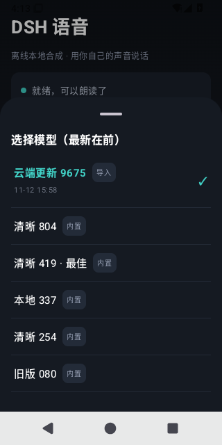

# DSH 语音（Voice）

> 完全离线的安卓 TTS：把自训练的 VITS 声音模型装进手机，输入文字即可用「自己的声音」朗读。


**包名** `dev.dsh.voice` · **当前版本** 7.0 · **最低系统** Android 8.0（API 26） · **合成引擎** sherpa-onnx OfflineTTS（VITS）

DSH 语音是 [DSH 桥接器及相关安卓软件](../../README.md) 系列中的离线语音合成 App：模型和合成引擎都跑在手机本地，断网也能用。需要换声音时，通过局域网里的电脑桥接器检查更新，下载新的模型包并一键启用；App 内还内置了一个音乐播放器，用来回放合成结果和手机里的音频。

## 功能

### 离线合成
- 输入文字后在本机完成合成，全过程不联网（首次需已装好模型）
- 长文本按 `。！？；` 等标点自动分句，短句合并到约 40 字再逐句合成
- 合成过程显示进度、已用时间与预计剩余时间；完成后显示音频时长、合成耗时和实时率（RTF）
- 语速 0.7×～1.4× 可调，设置持久保存
- 内置 5 条常用语快捷输入；输入框实时显示字数与预计朗读时长

### 播放与保存
- 合成结果立即播放，同时保存为 **16 bit 单声道 WAV**（采样率由模型决定）
- 保存位置：手机 `音乐/DSH语音/`，文件名形如 `小智_TTS_<yyyyMMdd_HHmmss>.wav`（Android 10+ 通过 MediaStore 写入，无需存储权限）
- 内置音乐播放器：读取 `音乐/DSH语音` 下的音频，支持进度拖动、上一首 / 播放暂停 / 下一首、刷新列表和「添加音频」导入本地文件

### 模型管理
- **内置模型**：`app/src/main/assets/models/<模型名>/` 下的模型随 APK 打包，可放多个
- **导入模型**：通过系统文件选择器选择模型 zip，导入到 App 私有目录并立即切换
- 模型抽屉按时间倒序显示「内置 / 导入」模型，显示来源标签和导入时间，当前模型打勾
- 启动时自动加载上次使用的模型；加载失败会显示状态并写入诊断日志

### 模型与 App 更新
- **模型热更新**：从电脑桥接器检查 `/app/voicemodel/version`，显示模型名称、版本、大小、发布时间；下载 `/app/voicemodel/latest.apk`（实际是模型 zip）后自动导入并启用
- **App 自更新**：检查 `/app/voice/version`，下载 `/app/voice/latest.apk` 后调起系统安装器
- 桥接器地址可随时修改，默认按 `<电脑IP>:8799` 处理（自动补全 `http://` 和端口）

### 诊断
- 页面底部可展开运行日志；未捕获异常会追加到 App 私有目录的 `app.log`，便于排查模型加载和更新问题

## 截图

| 模型选择（最新在前） |
|---|
|  |

> 截图来自开发过程，界面细节可能与当前版本略有差异。

## 工作原理

### 合成链路

```
输入文本
  └─ splitChunks()：按 。！？；; 和换行分句，合并到约 40 字
       └─ OfflineTts.generate(句子, speaker=0, speed)
            └─ 逐句得到 PCM（采样率由模型决定）
                 └─ 拼接 → WAV(16 bit/mono) → MediaPlayer 播放
                      └─ MediaStore 保存到 音乐/DSH语音
```

- 运行时配置：VITS 模型，`noiseScale=0.6`、`noiseScaleW=0.7`、`lengthScale=1.0`，`numThreads=4`，CPU 推理，`maxNumSentences=1`
- 每句单独调用 `generate`，因此长文本有进度反馈，也不会一次性占用过多内存
- 单例 `OfflineTts` 在切换模型时释放旧引擎，避免重复占用内存

### 模型资产

模型是三件套，必须齐全：

```
model.onnx      # 导出的 VITS 模型（sherpa-onnx 格式）
tokens.txt      # 音素表
lexicon.txt     # 中文发音词典（字/词 → 音素）
```

- **内置**：`apps/voice/app/src/main/assets/models/<模型名>/`，仓库不包含模型文件（`.gitignore` 忽略 `*.onnx`），结构说明见该目录下的 `PLACE_MODELS_HERE.md`
- **导入 zip**：包内按文件名识别上述三个文件，可附带 `meta.json`（`{"name": "模型显示名"}`）；模型目录名取自 `meta.json.name`，缺省为「导入模型」，非法字符会被替换
- 导入后的模型存放在 App 私有目录，卸载 App 即删除

### 更新/分发链路

电脑端桥接器同时充当模型分发服务器，目录约定：

```
bridge/app/voicemodel/version.json   # { name, versionCode, versionName, size, sha256, publishedAt }
bridge/app/voicemodel/latest.apk     # 实际是模型 zip（含 model.onnx/tokens.txt/lexicon.txt/meta.json）
```

手机端流程：

```
检查更新 → GET /app/voicemodel/version → 显示名称/版本/大小/发布时间
        → GET /app/voicemodel/latest.apk → 流式下载并显示进度
        → 解压到 App 私有模型目录 → 立即加载并启用
```

App 自更新走同一套约定：`bridge/app/voice/{version.json,latest.apk}`，接口为 `/app/voice/version` 与 `/app/voice/latest.apk`。协议细节见 [docs/PROTOCOL.md](../../docs/PROTOCOL.md)。

### 模型准备与导出

1. 用 VITS 在语料上微调（采集工具见 [DSH 语料](../corpus/README.md)）
2. 按 sherpa-onnx 官方流程导出为 `model.onnx` + `tokens.txt` + `lexicon.txt`
3. **确保 onnx metadata 里有非空的 `comment` 字段**——sherpa-onnx 要求该字段存在，否则加载失败；仓库内附的发布脚本会自动补写
4. 需要热更新时，把三件套和 `meta.json` 打成 zip，按上面的目录约定发布；也可以把模型直接放进 `assets/models/` 重新构建 APK

## 权限说明

| 权限 | 用途 |
|---|---|
| `INTERNET` | 连接电脑桥接器，检查/下载模型与 App 更新 |
| `REQUEST_INSTALL_PACKAGES` | 下载新 APK 后调起系统安装器（需用户允许安装未知来源） |
| 明文 HTTP（`usesCleartextTraffic`） | 桥接器是局域网 HTTP 服务，需允许明文请求 |

- 不需要麦克风、相机、通讯录等权限
- Android 10+ 保存音频走 MediaStore，不需要存储权限；Android 8/9 写入公共音乐目录可能受系统存储权限限制（见「已知限制」）

## 构建

通用环境（JDK 17、Android SDK 35、Gradle 8.9）与各 App 的差异说明见 [docs/BUILD.md](../../docs/BUILD.md)。

```powershell
# 设置 JAVA_HOME / ANDROID_HOME / GRADLE_HOME 后，在仓库根目录执行
pwsh -File apps/voice/build-apk.ps1
# 产物：apps/voice/app-debug.apk
```

本 App 额外依赖：

- **sherpa-onnx AAR**：工程通过 `app/libs/` 下的 sherpa-onnx AAR（当前为 1.13.8）集成运行时；若克隆的仓库里没有该文件，请自行下载同版本放入 `app/libs/`（体积约 48 MB）
- **模型**：仓库不附带任何模型，构建前需按上面的「模型资产」放到 `assets/models/<模型名>/`，否则 App 能编译但无法合成
- 只打包 `arm64-v8a` 和 `armeabi-v7a` 两种 ABI

## 数据格式

### 模型 zip

```
model.onnx
tokens.txt
lexicon.txt
meta.json        # 可选：{"name": "本地混合_ep500"}
```

zip 内文件可带目录前缀，App 只按文件名匹配上述四个文件。

### 合成结果

- 格式：RIFF/WAVE，PCM 16 bit、单声道，采样率跟随模型
- 位置：`音乐/DSH语音/`（可通过文件管理器访问）
- 文件名：`小智_TTS_<yyyyMMdd_HHmmss>.wav`

### 桥接器 version.json

```json
{
  "name": "本地混合_ep500",
  "versionCode": 500,
  "versionName": "ep500",
  "size": 43210000,
  "sha256": "<hex>",
  "publishedAt": "2026-11-13T12:00:00+08:00"
}
```

App 用 `versionCode` 与本地模型/APK 版本比较；模型包内还会带 `meta.json` 用于生成模型显示名。

## 已知限制

- **模型不随仓库分发**：仓库里只有占位说明；没有模型时 App 能启动，但无法合成
- 模型面向中文单说话人 VITS：音质取决于训练数据；多音字、英文/数字依赖 `lexicon.txt`，可能出现读音不准
- 只打包 ARM ABI，x86 模拟器无法加载 TTS 原生库
- 模型/App 更新依赖电脑桥接器与网络（同一 Wi-Fi 或 Tailscale 等虚拟局域网）；APK 安装需允许未知来源
- 长文本按句串行合成，不是流式播放；句与句之间可能有短暂停顿
- 音乐播放器运行在 App 内（无前台服务/通知控制），切到后台长时间后可能被系统回收
- Android 8/9 上写入公共音乐目录需要存储权限，当前版本未申请，可能保存失败但不影响播放

## 致谢

- [sherpa-onnx](https://github.com/k2-fsa/sherpa-onnx)：离线语音合成/识别运行时（Apache-2.0）
- [VITS](https://github.com/jaywalnut310/vits)：端到端语音合成模型结构
- AndroidX / Jetpack Compose（Apache-2.0）
- 模型由本人的语料训练而来；第三方组件遵循其各自许可证

## License

MIT，见仓库根目录 [LICENSE](../../LICENSE)。
